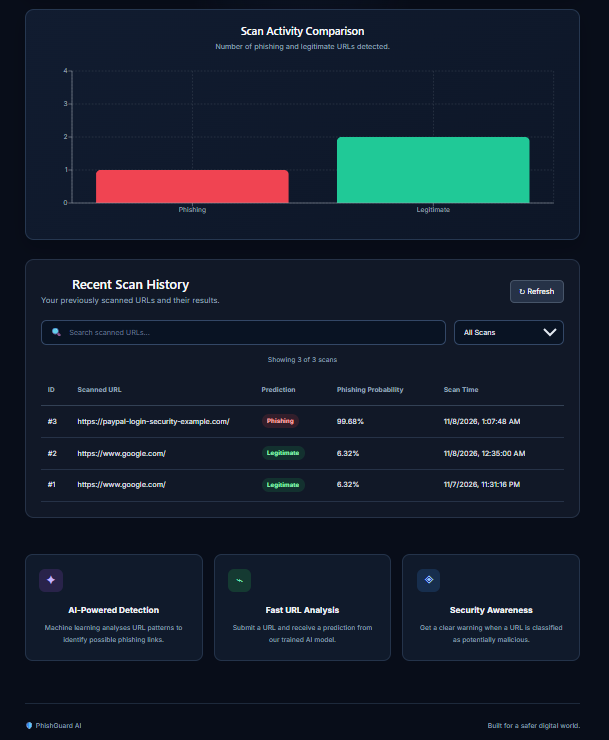

# 🛡️ PhishGuard AI
### AI-Powered Phishing URL Detection System

PhishGuard AI is a machine-learning-based web application that detects whether a URL is potentially phishing or legitimate.

Phishing websites are designed to steal sensitive information such as passwords, banking details, and personal data. PhishGuard AI analyzes URL patterns using a trained Machine Learning model and provides a prediction through a simple web dashboard.

🌐 **Live Demo:** https://phishguard-ai-2lw.pages.dev/

🔗 **Backend API:** https://phishguard-ai-f65t.onrender.com/

📂 **GitHub Repository:** https://github.com/Lavanyakapoor12/PhishGuard-AI

---


## 📸 Project Screenshots

### PhishGuard AI Dashboard


### Analytics and Scan History



## ✨ Key Features

- AI-based phishing URL detection.
- Character-level TF-IDF with Logistic Regression.
- Real-time URL scanning through a web interface.
- Prediction results with phishing probability.
- FastAPI backend for prediction processing.
- PostgreSQL database for storing scan history.
- Dashboard with scan statistics and analytics.
- Search and filter options for previous scans.
- REST API with Swagger documentation.
- Responsive design for desktop and mobile devices.
- Automated API testing using Pytest.
- Docker and Docker Compose support.
- GitHub Actions CI workflow.

---

## 🛠️ Technologies Used

| Area | Technologies |
|---|---|
| Frontend | React.js, Vite, CSS |
| Charts | Recharts |
| Backend | Python, FastAPI, Pydantic |
| Machine Learning | Scikit-learn, TF-IDF, Logistic Regression |
| Database | PostgreSQL, SQLAlchemy |
| Model Management | Joblib |
| Testing | Pytest, HTTPX |
| DevOps | Docker, Docker Compose, GitHub Actions |
| Deployment | Cloudflare Pages, Render, Neon PostgreSQL |
| Version Control | Git and GitHub |

---

## 🤖 Machine Learning Model

PhishGuard AI uses a **character-level TF-IDF vectorizer combined with a Logistic Regression classifier**.

The model analyzes character patterns in URLs and predicts one of two classes:

- **Legitimate:** The URL is predicted as legitimate.
- **Phishing:** The URL is predicted as potentially phishing.

### Dataset

The project uses the PhiUSIIL Phishing URL Dataset from the UCI Machine Learning Repository.

| Dataset Details | Count |
|---|---:|
| Total records | 235,795 |
| Legitimate URLs | 134,850 |
| Phishing URLs | 100,945 |

### Model Performance

| Metric | Result |
|---|---:|
| Test accuracy | 99.66% |

The reported accuracy was measured on a held-out test split of the dataset.

**Important:** This result does not guarantee the same performance on new or real-world URLs. Further testing on unseen domains and external datasets is needed.

Dataset source:  
https://archive.ics.uci.edu/dataset/967/phiusiil+phishing+url+dataset

Dataset citation: Prasad and Chandra (2024).

---

## ⚙️ How the Project Works

1. The user enters a website URL in the React frontend.
2. React sends the URL to the FastAPI backend.
3. The backend validates the submitted URL.
4. The trained Machine Learning model analyzes its URL text.
5. The model predicts whether the URL is phishing or legitimate.
6. The prediction and phishing probability are returned to the frontend.
7. Scan details are stored in PostgreSQL.
8. Users can view their previous scans and dashboard statistics.

**Security note:** The application analyzes URL text. It does not open or visit the submitted website.

---

## 🏗️ Project Architecture

```text
                 USER
                   |
                   v
            REACT FRONTEND
              (Vite + CSS)
                   |
                   | HTTP Request
                   v
             FASTAPI BACKEND
                   |
          +--------+--------+
          |                 |
          v                 v
    ML MODEL              DATABASE
 TF-IDF + Logistic       PostgreSQL
  Regression            (Neon)
          |                 |
          +--------+--------+
                   |
                   v
             PREDICTION
                   |
                   v
             WEB DASHBOARD
```

---

## 📁 Project Structure

```text
PhishGuard-AI/
│
├── backend/
│   ├── main.py
│   ├── database.py
│   ├── models.py
│   └── Dockerfile
│
├── frontend/
│   ├── src/
│   ├── public/
│   └── Dockerfile
│
├── ml/
│   ├── train_url_model.py
│   └── phishguard_url_model.pkl
│
├── dataset/
│   ├── download_dataset.py
│   └── selected_features.csv
│
├── tests/
│   └── test_api.py
│
├── deployment/
│
├── .github/
│   └── workflows/
│
├── docker-compose.yml
├── requirements.txt
├── .env.example
├── .gitignore
└── README.md
```

---

## 🚀 Live Deployment

The application is deployed using free-tier cloud services.

| Component | Platform |
|---|---|
| Frontend | Cloudflare Pages |
| Backend | Render |
| Database | Neon PostgreSQL |

**Live Application:**  
https://phishguard-ai-2lw.pages.dev/

**Backend API:**  
https://phishguard-ai-f65t.onrender.com/

**API Documentation:**  
https://phishguard-ai-f65t.onrender.com/docs

Note: The free Render backend may take some time to respond after a period of inactivity.

---

## 💻 Run the Project Locally

### Prerequisites

Install the following tools:

- Python
- Node.js and npm
- PostgreSQL
- Git
- Docker Desktop (optional)

### Step 1: Clone the repository

```bash
git clone https://github.com/Lavanyakapoor12/PhishGuard-AI.git
```

### Step 2: Open the project folder

```bash
cd PhishGuard-AI
```

### Step 3: Create a Python virtual environment

```bash
python -m venv venv
```

### Step 4: Activate the environment

Windows PowerShell:

```powershell
venv\Scripts\Activate.ps1
```

### Step 5: Install Python dependencies

```bash
pip install -r requirements.txt
```

### Step 6: Configure environment variables

Create a `.env` file in the root project folder.

Add your own PostgreSQL credentials:

```env
DB_USER=your_database_username
DB_PASSWORD=your_private_password
DB_HOST=localhost
DB_PORT=5432
DB_NAME=phishguard_db
```

Never upload your actual `.env` file or database credentials to GitHub.

### Step 7: Start the backend

From the project root:

```bash
uvicorn backend.main:app --reload
```

Backend:

http://127.0.0.1:8000

Swagger API documentation:

http://127.0.0.1:8000/docs

### Step 8: Start the frontend

Open another terminal:

```bash
cd frontend
```

Install frontend dependencies:

```bash
npm install
```

Create `frontend/.env.local` and configure the backend URL:

```env
VITE_API_URL=http://127.0.0.1:8000
```

Start the frontend:

```bash
npm run dev
```

Open the local URL displayed in your terminal.

---

## 🐳 Run Using Docker

Make sure Docker Desktop is running.

From the project root, execute:

```bash
docker compose up -d --build
```

Check running containers:

```bash
docker compose ps
```

View backend logs:

```bash
docker compose logs backend --tail 40
```

Open the application:

- Frontend: http://localhost:5173
- Backend: http://localhost:8000
- API Documentation: http://localhost:8000/docs

Stop the containers:

```bash
docker compose down
```

---

## 🧪 Testing

The project includes automated API tests using Pytest.

The tests cover:

- Home endpoint.
- Valid URL prediction.
- Invalid URL handling.
- Scan history.
- Dashboard statistics.
- Empty URL validation.
- Missing URL validation.
- JavaScript URL validation.
- File URL validation.
- Maximum URL length validation.

Run the tests:

```bash
python -m pytest tests/test_api.py -v
```

**Latest reported result: 10 tests passed.**

The project also uses GitHub Actions to run automated tests through a CI workflow.

---

## 🔐 Security Considerations

- The system analyzes URL text without visiting the submitted website.
- URL input is validated before prediction.
- Maximum URL length is restricted to 2048 characters.
- Database credentials are stored in environment variables.
- The `.env` file is excluded from Git tracking.
- Predictions are estimates, not guarantees of website safety.
- The model should be tested regularly against new phishing techniques.

---

## 🔮 Future Improvements

- Improve detection on previously unseen domains.
- Test the model using additional external datasets.
- Add advanced phishing detection techniques.
- Implement user authentication and individual scan histories.
- Generate detailed security reports.
- Add more detailed application monitoring and logging.
- Improve model explainability.

---

## 👩‍💻 Author

**Lavanya Kapoor**

B.Tech Student – Computer Science and Business Systems

GitHub:  
https://github.com/Lavanyakapoor12

**Project:** PhishGuard AI – AI-Powered Phishing URL Detection System
